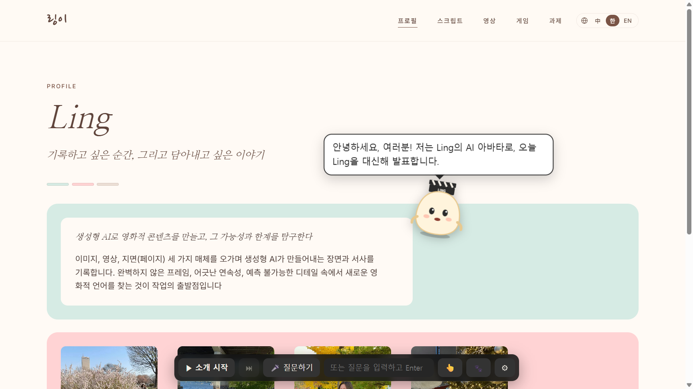

# Ling AI Presenter 사용 가이드

AI 아바타가 제 포트폴리오 사이트를 **사람처럼 각색해서 소개**하고, 발표가 끝나면 **여러분의 질문에 목소리로 답하는** 앱입니다.
아바타는 저(Ling)를 대신해 1인칭으로 말합니다.

---

## 1. 설치·실행

> 실행 파일 받기: https://github.com/lingyi-sketch/week9-ling-presenter/releases/latest

### Windows
1. 위 주소에서 `Ling-AI-Presenter-Windows.exe`를 받아 더블클릭합니다. (설치 과정 없이 바로 실행됩니다)
2. "Windows의 PC 보호" 창이 뜨면 **추가 정보 → 실행**을 누릅니다. (서명되지 않은 학생 프로젝트라서 나오는 안내입니다)

### Mac
**방법 1 — 앱 받기**
> Apple 유료 인증서로 서명하지 않은 학생 프로젝트라서, macOS가 처음 한 번 실행을 막습니다. 아래 2번을 한 번만 해 주시면 그다음부터는 바로 열립니다.

1. **내 Mac에 맞는 파일 고르기** — 화면 왼쪽 위  › **이 Mac에 관하여**에서 「칩」을 봅니다.
   - **Apple M1·M2·M3·M4…** → `Ling-AI-Presenter-Mac-arm64.zip`
   - **Intel** → `Ling-AI-Presenter-Mac-x64.zip` (arm64 파일은 Intel Mac에서 열리지 않습니다)
2. zip을 더블클릭해 압축을 풀고, 나온 **Ling AI Presenter**를 **응용 프로그램** 폴더로 옮깁니다.
3. **실행 허용** — **터미널**(Spotlight에서 "터미널" 검색)을 열고 아래를 붙여 넣은 뒤 Enter를 누릅니다.
   ```
   xattr -cr "/Applications/Ling AI Presenter.app"
   ```
   (응용 프로그램 폴더가 아닌 곳에 두었다면, `xattr -cr ` 까지 입력한 뒤 앱을 터미널 창에 끌어다 놓고 Enter)
4. 앱을 더블클릭해 엽니다.
   - 그래도 "열 수 없습니다"가 나오면 **시스템 설정 › 개인정보 보호 및 보안**을 열고, 아래쪽 「"Ling AI Presenter"이(가) 차단되었습니다」 옆의 **그래도 열기**를 누릅니다. (macOS 15 이후에는 우클릭 › 열기로는 열리지 않습니다)

**방법 2 — 소스로 실행** (Node.js 18 이상 필요)
```
npm install
npm start
```

처음 실행할 때 마이크 사용 권한을 물으면 **허용**을 누릅니다.

---

## 2. 처음 한 번만: API 키 넣기

> **소개 발표만 볼 때는 키가 필요 없습니다.** 대본과 목소리(Bella)가 앱 안에 들어 있어서 ▶ 소개 시작을 누르면 바로 재생됩니다.

**질의응답**에는 Google Gemini API 키가 필요합니다. (무료)

1. https://aistudio.google.com/apikey 에 Google 계정으로 들어가 **Create API key**를 누르고 키(`AIza…`)를 복사합니다.
2. 앱 화면 아래 조작 바에서 **⚙** 를 누릅니다.
3. 첫 칸 **Gemini API 키**에 붙여 넣고 **연결 테스트** → "연결 성공"이 나오면 **저장**.

**새로 만드는 답변도 같은 목소리(Bella)로** 들으려면 ElevenLabs API 키도 넣습니다. (무료 플랜 가능, 없으면 새 답변은 OS 기본 음성으로 나옵니다)

1. https://elevenlabs.io 에 가입 → **API Keys** → **Create API Key**. 권한은 Text to Speech, Voices(Read), User(Read)를 켭니다.
2. ⚙ → **ElevenLabs API 키**에 붙여 넣고 **목록 불러오기** → 목소리 목록이 나오면 **저장**.

> 키는 내 PC에만 저장되고 다른 곳으로 보내지지 않습니다. 다른 사람에게 키를 공유하지 마세요.

---

## 3. 화면 구성



| 위치 | 이름 | 하는 일 |
|---|---|---|
| 가운데 | 포트폴리오 사이트 | 실제 사이트가 앱 안에 열립니다. 평소처럼 스크롤·클릭할 수 있습니다 |
| 마우스 옆 | 아바타 + 말풍선 | 마우스를 따라다니고, 말하는 문장을 말풍선으로 보여 줍니다 |
| 아래 | 조작 바 | 마우스를 올리면 선명해집니다 |

**조작 바 버튼**

| 버튼 | 단축키 | 설명 |
|---|---|---|
| ▶ 소개 시작 / ■ 멈춤 / ▶ 이어서 | F1 | 포트폴리오 소개 발표 |
| ⏭ | | 발표 중 다음 구간으로 넘어가기 |
| 🎤 질문하기 | F2 | 한 번 누르고 말하기 → 다시 누르면 질문 전송 |
| 입력칸 | Enter | 질문을 글로 입력 |
| 👆 | F4 | 가리켜서 설명 모드: 켜고 페이지의 카드·문단을 클릭 |
| 🐾 | F3 | 마우스 따라다니기 켜기·끄기 |
| ⚙ | | 설정 |
| | Esc | 말하기 멈춤 |

---

## 4. 발표하는 순서

### ① 소개 (약 10분)
1. **▶ 소개 시작**(F1)을 누릅니다.
2. 인사 → 대본 작품 → 영상 → 게임 → 3주차~8주차 과제 → 마무리 순서로, 제(Ling) 목소리처럼 1인칭으로 발표합니다.
3. 발표하는 동안
   - 작품 이름 같은 **핵심 문장을 말하기 직전에** 그 부분이 금색 테두리로 강조되고, 아바타가 그 옆으로 갑니다.
   - 구간 끝 "다음은 ○○예요" 같은 말이 나오는 동안 **다음 페이지로 넘어가서**, 끊김 없이 이어집니다.
4. 중간에 멈추고 싶으면 **■ 멈춤**, 다시 누르면 멈춘 곳부터 **이어서** 합니다.

### ② 질의응답
1. 질문자가 말하기 전에 **🎤 질문하기**(F2)를 누릅니다. 아바타가 손을 들고 "듣고 있어요"라고 합니다.
2. 질문이 끝나면 버튼(**⏺ 질문 보내기**)을 한 번 더 누릅니다.
3. 바로 "아, 네." 같은 **맞장구**가 나오고(답이 늦으면 "잠깐만요…"가 한 번 더), 관련 페이지로 이동한 뒤 1~3문장으로 답합니다.
   - 미리 준비한 **예상 질문 7개**(앱 제작, AI와 저자성, 가장 아끼는 작품, 『가면』, 『모탈리티 클로즈』, 5주차 프롬프트 구조화, 앞으로의 작업)는 저장된 답변이 바로 나옵니다. (한국어 질문만)
   - 포트폴리오에 없는 내용은 지어내지 않고 "포트폴리오에는 그 내용이 없다"고 말합니다.
   - 한국어로 물으면 한국어로, 중국어·영어로 물으면 그 언어로 답합니다.
4. 마이크가 어려운 환경이면 아래 **입력칸**에 질문을 적고 Enter를 누릅니다.

### ③ 가리켜서 설명 (선택)
1. **👆**(F4)를 누르면 커서가 물음표로 바뀝니다.
2. 페이지에서 마우스를 올리면 점선 테두리가 생기고, **클릭**하면 아바타가 그곳으로 다가가 설명합니다.
3. 다시 **👆**를 누르면 원래대로 돌아옵니다.

---

## 5. 설정 (⚙)

| 항목 | 설명 |
|---|---|
| Gemini API 키 | 2번 참고 |
| 포트폴리오 주소 | 소개할 사이트 주소 |
| 발표 언어 | 한국어 / 中文 / English |
| 소개 길이(분) | 새 대본을 만들 때의 목표 길이 |
| 목소리 | 자동(선택한 서비스 → 실패 시 OS 음성) / 선택한 서비스만 / OS 음성만 |
| 음성 서비스 | **ElevenLabs**(기본) / Gemini |
| ElevenLabs API 키·목소리·모델 | 기본 목소리 **Bella**, 모델 `eleven_multilingual_v2`. 🔒 표시 목소리는 무료 플랜에서 못 씁니다 |
| Gemini 목소리 | ElevenLabs 대신 Gemini를 쓸 때. 기본 **Leda** |
| 목소리 듣기 | 지금 고른 목소리로 한 문장을 들어 봅니다 |
| 캐릭터 성격 | 아바타의 말투와 배경 (프롬프트) |
| 연결 테스트 | API 키 확인 |
| 사이트 다시 읽기 | 사이트 내용을 고친 뒤 누르면 최신 내용을 다시 읽습니다 |
| 소개 대본 새로 만들기 | 사이트 내용으로 대본을 다시 씁니다 |
| 발표 음성 미리 만들기 | 대본·맞장구·예상 답변 음성을 미리 만들어 저장 (아래 6번) |
| 소개 대본 보기 · 고치기 | 대본을 직접 수정하고 「대본 저장」 |
| 맞장구 · 예상 질문 보기 · 고치기 | 맞장구 문구와 예상 질문·답변을 고치고 「맞장구·예상 질문 저장」 |

**대본 고치는 형식**

```
[2] /script
대본은 모두 여덟 편을 올려 두었는데, …
진회영이라는 작품입니다.
★ 강조: 秦淮影
» 이 이야기들이 영상으로는 어떻게 만들어졌는지 볼게요.
```
- `[번호]` 뒤에는 그 구간에서 보여 줄 페이지 경로를 쓰고, 다음 줄부터 **한 줄에 한 문장**씩 씁니다.
- `★ 강조: 글자` — 바로 위 문장을 말하기 직전에, 화면에서 그 글자가 있는 부분을 강조합니다. 글자가 없는 게임 화면은 `게임 화면`(두 번째는 `게임 화면 2`)이라고 씁니다.
- `↪ 이동: /경로` — 바로 위 문장을 말할 때 그 페이지로 넘어갑니다. 구간 중간에 잠깐 다른 페이지를 보여 주고 돌아올 때 씁니다.
- `» 문장` — 구간 마지막 문장. 이 말을 시작할 때 다음 페이지로 넘어갑니다.
- 문장을 고치면 그 구간 음성은 6번의 「발표 음성 미리 만들기」로 다시 만들어야 합니다.

---

## 6. 발표 전에 꼭 할 일

1. ⚙ → **발표 음성 미리 만들기** (대본이나 예상 답변을 고쳤을 때만. 배포본에는 이미 들어 있습니다)
   - 소개 12구간 + 맞장구 6개 + 예상 답변 7개, 약 4,800자를 만듭니다. 이미 있는 것은 건너뜁니다.
   - 미리 만들어 두면 리허설·발표 때 **사용량을 쓰지 않고**, 매번 같은 목소리로 발표합니다.
   - 한도에 걸리면 앱이 기다렸다가 다시 시도합니다. 끝까지 안 되면 나중에 다시 누르면 이어서 만듭니다.
2. 리허설은 소개 위주로 하고, **새 질문 테스트는 몇 번만** 합니다. (새 질문 1번 = Gemini 1회 + 음성 1회 사용, 예상 질문은 음성 0회)
3. 마이크 확인: Windows 설정 › 시스템 › 소리 › 입력에서 말할 때 막대가 움직이는지 봅니다.

---

## 7. 이럴 때는

| 상황 | 해결 |
|---|---|
| "API 키를 먼저 입력해 주세요" | 2번 참고 |
| "무료 사용량 한도에 걸렸습니다(429)" | 잠시 후 다시. 하루 한도는 매일 오후 4~5시(한국 시간)쯤 초기화됩니다 |
| "서버가 붐빕니다(503)" | 앱이 자동으로 다른 모델로 재시도합니다. 계속되면 잠시 후 다시 |
| 목소리가 갑자기 기계음으로 바뀜 | 음성 서비스(ElevenLabs·Gemini) 사용량이 끝났거나 키가 없어 OS 음성으로 바뀐 것입니다. 소개·맞장구·예상 답변은 미리 만든 음성이라 영향이 없습니다 |
| ElevenLabs 「목록 불러오기」를 눌러도 목록이 안 나옴 | 키 권한에 Voices(Read)가 없습니다. elevenlabs.io › API Keys에서 권한을 켜 주세요 |
| 목소리를 골랐는데 소리가 안 남(🔒) | 라이브러리 목소리는 무료 플랜에서 쓸 수 없습니다. 기본 목소리(Bella 등)를 고르세요 |
| "마이크에서 소리가 전혀 들어오지 않아요" | 키보드의 마이크 끄기 키(노트북은 보통 F4), Windows 입력 음량 확인. 급하면 입력칸에 글로 질문 |
| 사이트를 고쳤는데 반영이 안 됨 | ⚙ → 사이트 다시 읽기 → 소개 대본 새로 만들기 |
